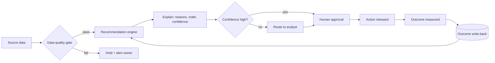

# The decision loop

A human-in-the-loop pattern for AI recommendations. Each control exists because a specific stakeholder asked for it in `personas/`.

| Control | Why it exists | Who asked |
|---|---|---|
| Data-quality gate | Bad inputs produce confident wrong answers | VP RevOps, Chief AI Officer |
| Explain step | Unexplained recommendations get ignored | CRO, Chief AI Officer |
| Confidence routing | Low confidence goes to a person, not to production | Chief AI Officer |
| Human approval | Accountability stays with a named person | CRO, CEO |
| Outcome write-back | Results are measured, not assumed | CFO |
